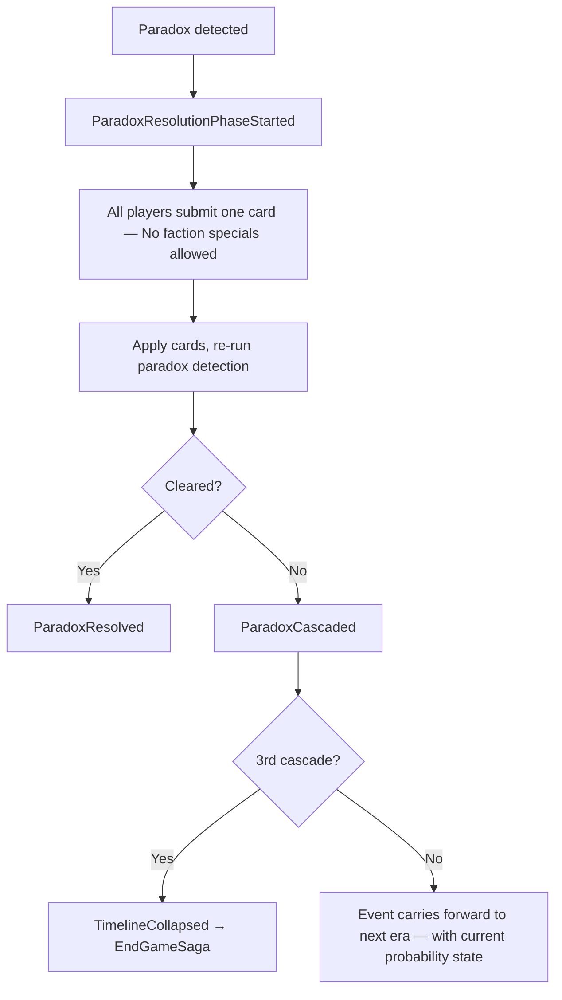

Paradoxes occur when contradictory conditions exist simultaneously on the same event at resolution time.

## Paradox types

| Type | Trigger | `paradoxType` |
|---|---|---|
| **Dead Heat** | Two outcomes a Collide equalized this era are still tied for the highest eligible probability | `DEAD_HEAT` |
| **Impossible Erasure** | Erasure leaves no eligible outcome with any probability, or no eligible outcome at all. Legal play never reaches this: an erasure the other outcomes can't absorb is rejected | `IMPOSSIBLE_ERASURE` |
| **Chain Conflict** | A Weaver chain's pending link is Annihilated, even under Tapestry protection. Cascading breaks the chain unless Tapestry protected that link, in which case only the link clears; clearing the paradox saves the chain but not the link, since the erased outcome can't win | `CHAIN_CONFLICT` |
| **Fate Contradiction** | The outcome a Prophet wrote for the event is Annihilated (in or after the round it was written). Cleared, neither side scores for that event; cascading carries the event into the next era, where both can act on it again | `FATE_CONTRADICTION` |

An ordinary tie is not a paradox. If outcomes tie for the lead without a Collide — after a Suppress, for example — the
weighted draw makes them equally likely. Erasing the leading outcome is not a paradox either: its probability moves
to the remaining outcomes, which are drawn by their new probabilities. A Collide only counts for the
era it was played, so a tie carried into the next era needs a new Collide to raise a Dead Heat. Cards in a round resolve simultaneously, so any other card
that moves the same event's probabilities that round can break a Collide's tie. A Collide on two
outcomes that are already tied still counts: the weights don't change, but the tie now raises a Dead Heat. A Seal locks
an outcome's probability through the era; an effect that would move that weight is blocked without creating a paradox.

## Resolution flow

## Cascade rules

If one or more paradox findings remain on an event after the resolution phase, that **event cascades once**:
- The event produces no outcome for this era
- Score is zeroed for it this era
- The event carries forward to the next era with its probability state intact (not reset to its printed starting weights)

Each remaining finding is identified in the event's one cascade fact. Cleared findings are recorded separately.
Every player pays −2 for a cascaded event, and each player who played Detonate on it pays an extra −1. These
penalties apply once per cascaded event, even if several findings remain.

Resolution is a contest of the table. An event's paradoxes clear only when the players who played Stabilize on it
are at least as many as those who played Detonate on it (a tie clears), and at least one played Stabilize. Otherwise
the event is judged as if nobody had stabilized it, and it cascades if the paradox still holds. Clearing is free:
the players a paradox hurts, who are usually the ones who clear it, do not pay for it. Tearing time costs the one who
tears it. With the contest rule off, a single Stabilize clears and a Detonate doubles everyone else's penalty.

**3 cascaded events → `TimelineCollapsed`**. The era whose cascades raise the global count to three collapses the
timeline. The players with the highest total score win. With the score tiebreak on, players tied on score are separated by objective progress, and only players still tied share the win; everyone else loses this special ending.
